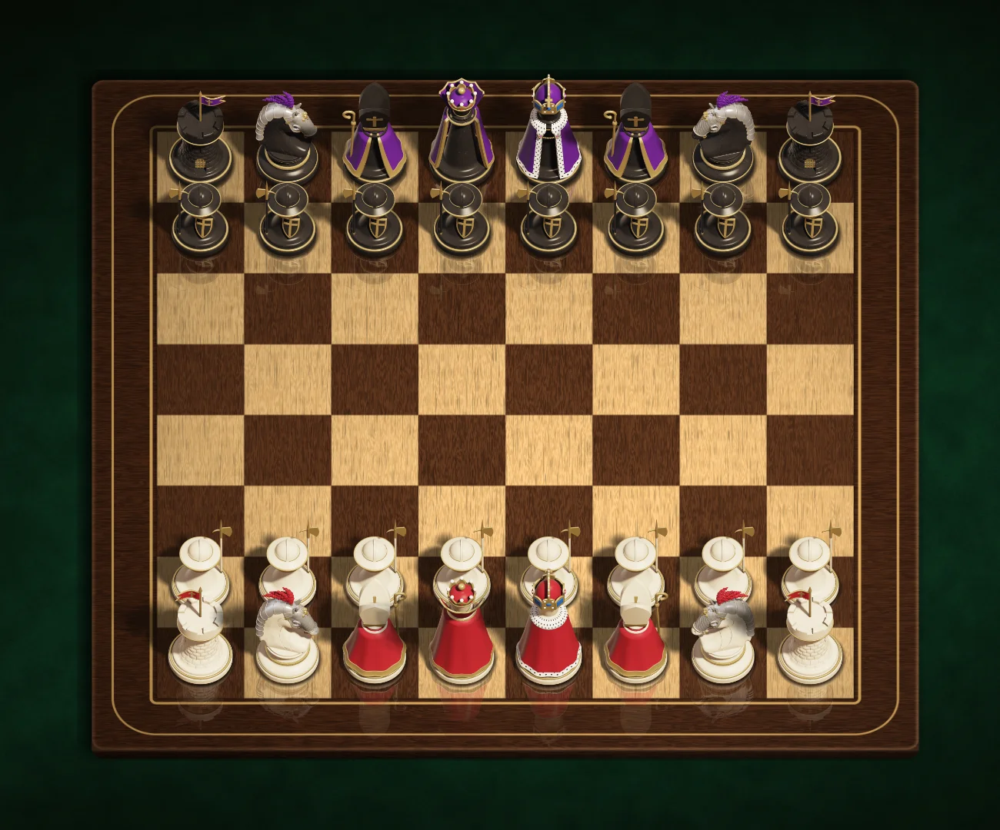

<div align="center">

# ♞ Chess

**Canvas chess against Stockfish or a friend, running on AWS.**

[](https://chess.aws-prac-route53.com/)

<a href="https://chess.aws-prac-route53.com/"></a>


**Home** · [Client](client/README.md) · [Server](server/README.md) · [Data service](data-service/README.md) · [Deploy](deploy/README.md) · [Terraform](terraform/README.md) · [Setup & fixes](SETUP.md)

</div>

---

A chess game drawn on an HTML5 canvas: sprite pieces with shadows and
reflections on a wooden table, sliding moves and move sounds. Play Stockfish at
8 levels or a friend by email.

Every move is checked three times: by chess.js in the browser, by the Express
server, and by the private **data service**, the only code that can touch
DynamoDB, which plays the move on the stored board itself.

**Built with:** vanilla JavaScript, HTML5 Canvas, Webpack 5, Express 5,
Socket.IO, [chess.js](https://github.com/jhlywa/chess.js), and
[Stockfish](https://stockfishchess.org/) through
[chess-engine-api](../chess-engine-api) (with
[js-chess-engine](https://github.com/josefjadrny/js-chess-engine) as backup).
AWS: two EC2 instances, DynamoDB, S3 + CloudFront, all in Terraform
([Deploy](deploy/README.md)). Deploy commands and fixes: [SETUP.md](SETUP.md).

## Features

| | |
| --- | --- |
| **Canvas** | Board, table and pieces are layered sprites (reflection, shadow, piece). Pieces face the way they last moved, and knights hop. |
| **Moving** | Drag and drop or click to move, with legal moves and check highlighted. Promote by clicking one of your captured pieces. Touch and a TV remote mode (`TV_DEV` in `client/src/js/pages/play/index.js`) work too. |
| **Play the AI** | 8 levels with approximate Elo ([AI levels](server/README.md#ai-levels)) and a color (Random, White, Black). The server picks and saves the AI's moves. Restart reuses the level and color; restarting an unfinished game is a forfeit. One open AI game per player. |
| **Play a friend** | Invite by email with your color. They Accept or Decline on Home, and moves arrive live over Socket.IO. One sent invite and one open friend game at a time; starting another forfeits after a second press. Forfeit asks first. |
| **Set positions** | An optional FEN in **Start position**. The server refuses broken or finished positions with the reason, and Restart and Rematch keep it. |
| **Game over** | Checkmate, stalemate, insufficient material, the fifty-move rule, threefold repetition or a forfeit. Both boards show the result. |
| **Rematch** | Both players press within 1 minute and a new game loads on both boards. "Can't rematch" when either is in another friend game. |
| **Ratings** | Elo from 1500. Only finished friend games (both sides moved, not from a set position) count. Shown on Home and in a friend game's menu. |
| **Usernames** | 3 to 20 letters, numbers, `_` or `-`, unique in any capitals, some reserved. Picked on Settings after the first sign-in. |
| **Settings** | `/settings`: username, account, default start settings, and Delete my data (forfeits your games, deletes your row and frees your username). |
| **Guests** | Play the AI without an account: one game, kept to the browser that made it. |
| **Mobile** | Portrait and landscape layouts, and iOS audio unlocks on the first tap. |

## How it works

1. **Page.** The server picks the page from the session cookie ([Pages](client/README.md#pages)).
   A guest's game id lives in localStorage (`GUEST_GAME_ID`) and is also their
   player id; a signed `guest_game` cookie keeps it to that browser.
2. **Load.** `renderCanvas()` loads every sprite, then `GET /api/chess/game/:gameId`
   (board, your color, the opponent). A guest without a game gets one first.
3. **Render loop.** About 33 fps, drawing only when something changed.
4. **Your move.** chess.js checks it, then `PUT /api/chess/game/:gameId`
   `{ move: [from, to], promotion }`. A refusal puts the board back. A move that
   ends the game returns `state: "CLOSED"`, `winner` and `reason`.
5. **AI move.** `POST /api/chess/game/:gameId/ai-move`: the server asks Stockfish
   at the saved level, checks and saves the move, and returns it. Asking again
   returns the same move.
6. **Friend's move.** The server emits `move` to the game's Socket.IO room, and
   the other client fetches the game and animates `prev_move`. After a
   reconnect it fetches once in case it missed something.

## Quick start

Requires Node 22+ (the server).

Install, then fill in the `.env` files ([client](client/README.md#setup), [server](server/README.md#setup), [data service](data-service/README.md)).
The copy below skips a `.env` that already exists, so it won't wipe your secrets.

```bash
npm ci                                                         # client (Webpack)
(cd server && npm ci && { [ -f .env ] || cp .env.example .env; }) # chess server
(cd data-service && npm ci && { [ -f .env ] || cp .env.example .env; })
```

Before starting, in the `.env` files:

- Set `CLIENT_URL=http://localhost:3002/` in `server/.env`, or login and logout
  send you back to :3001.
- Set the same `DATA_SERVICE_SECRET` in `server/.env` and `data-service/.env`
  (the command to make one is in `data-service/.env.example`).
- Make the session key pair: `SESSION_PRIVATE_KEY` in `data-service/.env`,
  `SESSION_PUBLIC_KEY` in `server/.env`
  ([Making the session keys](data-service/README.md#making-the-session-keys)).
  With the placeholders, both processes exit on start.

Then run the three processes in separate terminals and open http://localhost:3002.

```bash
cd data-service && npm run dev   # terminal 1: data service on http://127.0.0.1:8090
cd server && npm start           # terminal 2: chess server on http://localhost:3001
npm run dev                      # terminal 3: client on http://localhost:3002
```

`npm ci` installs the versions in the committed `package-lock.json`; add a
package with `npm install` in its folder and commit the lock file with it.

## Docs

| README | What's in it |
| --- | --- |
| [client/](client/README.md) | `client/.env`, the images and audio on S3, the run commands, every page, the Socket.IO client |
| [server/](server/README.md) | `server/.env`, the server tests, auth, the chess API, Socket.IO events, the AI levels |
| [data-service/](data-service/README.md) | Request signing, every data service route, the session keys, stored data, the data service tests |
| [deploy/](deploy/README.md) | The AWS deploy, step by step, and updating it |
| [terraform/](terraform/README.md) | The AWS resources, restoring a table, the data service instance and its upkeep windows |
| [SETUP.md](SETUP.md) | Deploy commands and a fix for each error |
| [CONTRIBUTING.md](CONTRIBUTING.md), [SECURITY.md](SECURITY.md), [ACCESSIBILITY.md](ACCESSIBILITY.md) | Contributing, reporting security problems and the session key rules, accessibility |

## Project layout

```text
client/          The browser game: pages, canvas gameplay, Socket.IO client (client/README.md)
server/          Express + Socket.IO: pages, auth, the chess API, the AI (server/README.md)
data-service/    The only code that reads and writes DynamoDB, on a private instance (data-service/README.md)
deploy/          systemd units and the nginx site (deploy/README.md)
terraform/       The AWS resources (terraform/README.md)
.github/
  workflows/ci.yml           GitHub Actions: server tests (with the data service), data service tests, the client build, ESLint and npm audit on every pull request
  workflows/codeql.yml       CodeQL scan of the JavaScript on every pull request and weekly
  dependabot.yml             Weekly update PRs for the npm packages and the pinned GitHub Actions
eslint.config.js  ESLint flat config for the whole repo (npm run lint); rules are warnings for now
```

## License

Proprietary, all rights reserved: see [LICENSE](LICENSE). To contribute, see
[CONTRIBUTING.md](CONTRIBUTING.md), and report security problems as described in
[SECURITY.md](SECURITY.md). Third-party packages keep their own licenses, and
Stockfish isn't included in this repo (see below).

## Stockfish license

The AI plays with [Stockfish](https://stockfishchess.org/), free software by
the Stockfish developers, distributed under the
[GNU General Public License version 3](https://github.com/official-stockfish/Stockfish/blob/sf_19/Copying.txt)
(GPL v3). Whenever Stockfish is distributed, the license and the full source
code (or a link to it) for that exact binary have to go with it, and any
changes to its source have to be released under GPL v3 too.

- **This repo doesn't include or ship Stockfish.** The chess server asks the
  [chess-engine-api](../chess-engine-api) service for moves, and the browser
  never downloads an engine. That service runs Stockfish built, unmodified,
  from the official
  [`sf_19` source](https://github.com/official-stockfish/Stockfish/tree/sf_19)
  (see the Stockfish license section in its README).
- **The EC2 instance's AMI has a Stockfish binary in it.** Keep it private.
  Sharing it, or making it public, distributes Stockfish, and then
  `Copying.txt` and a link to the `sf_19` source have to go with it.
- **The local `stockfish/` folder** (the unmodified Stockfish 17.1 source and
  the build used to measure the [AI levels](server/README.md#ai-levels)) is in `.gitignore`,
  so it's never committed. If you share it, or a binary built from it, keep
  its `Copying.txt` and source with it.

---

<div align="center">

**Home** · [Client](client/README.md) · [Server](server/README.md) · [Data service](data-service/README.md) · [Deploy](deploy/README.md) · [Terraform](terraform/README.md) · [Setup & fixes](SETUP.md)

</div>
